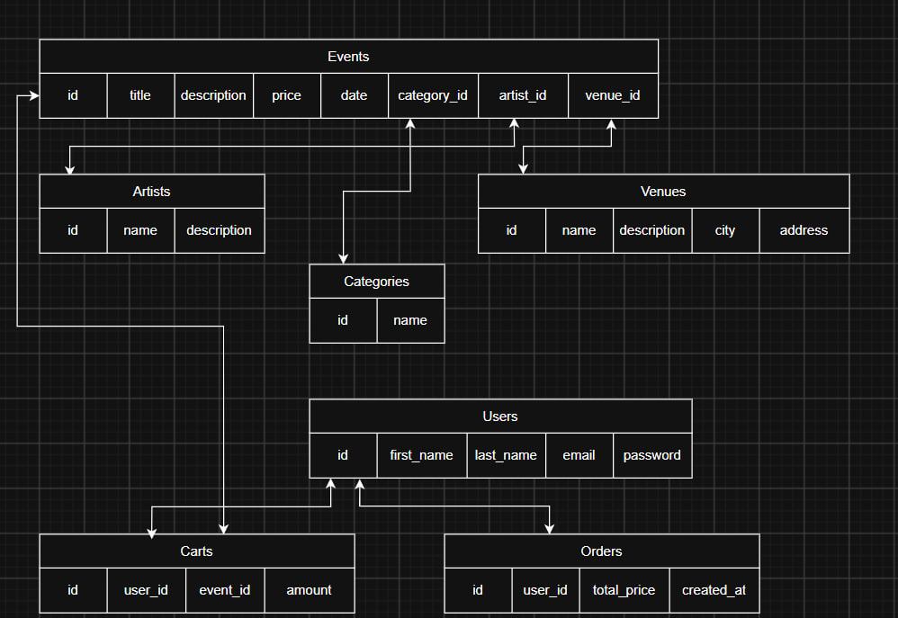

# Eventify - Платформа для купівлі квитків на події

## 📖 Опис та бізнес-логіка сайту

**Eventify** - це сайт для перегляду та купівлі квитків на різноманітні культурні та розважальні заходи (концерти, стендапи, театральні вистави, тощо). Сайт допомагає користувачам швидко знаходити цікаві події, фільтрувати їх за категоріями, майданчиками чи артистами, переглядати детальний опис заходу та купувати квитки.

### Що є на сайті з точки зору бізнес-логіки:
- **Каталог подій:**  Головна сторінка зі списком усіх заходів, пошуком за назвою, фільтрами (за категорією, майданчиком, тощо) та сортуванням (за ціною, датою проведення чи популярністю).
- **Сторінка події:**  Детальна інформація про конкретний захід, дата і час, вартість квитка, інформація про виконавця та локацію, а також кнопка купівлі.
- **Сторінка артистів:**  Список усіх виконавців/артистів. При переході на сторінку конкретного артиста відображаються всі його майбутні події.
- **Сторінка майданчиків (локацій):**  Перелік концертних залів, клубів чи театрів із можливістю переглянути події, які там відбуватимуться.
- **Авторизація та профіль:**  Можливість зареєструватися, зайти в акаунт, редагувати особисті дані та переглядати історію купівлі квитків.
- **Кошик і замовлення:**  Можливість додавати квитки на події в кошик та створювати замовлення однією кнопкою.
- **Інформаційна сторінка (Про нас):**  Контактні дані платформи, інформація про правила відвідування заходів та умови повернення квитків.

---

## ⚙️ Архітектура REST API

Усі запити та відповіді передаються у форматі **JSON**.

### 📌 Endpoint: Події (Events)
- **GET `/api/events`**
  - *Опис:* Отримати список усіх подій з можливістю пошуку, фільтрації та сортування.
  - *Query Parameters:* `search`, `category_id`, `venue_id`, `sort_by`.
  - *Response Status:* 200 OK
  - *Response Body:* 
    ```json
    [
      {
        "id": 1,
        "title": "СТЕНДАП ЗЙОМКА",
        "description": "Вітаємо! Хочете гарно провести час? Тоді вам на зйомку нового шоу!",
        "price": 450.00,
        "date": "2026-11-20T19:00:00Z",
        "category_id": 2,
        "artist_id": 5,
        "venue_id": 3
      }
    ]
    ```

- **GET `/api/events/{id}`**
  - *Опис:* Отримати детальну інформацію про конкретну подію за її ID.
  - *Response Status:* 200 OK 
  - *Response Body:*
    ```json
    {
      "id": 1,
      "title": "СТЕНДАП ЗЙОМКА",
      "description": "Вітаємо! Хочете гарно провести час? Тоді вам на зйомку нового шоу!",
      "price": 450,
      "date": "2026-11-20T19:00:00Z",
      "category": { "id": 2, "name": "Стендап" },
      "artist": { "id": 5, "name": "Дмитро Тютюн" },
      "venue": { "id": 3, "name": "Бочка PUB", "city": "Київ" }
    }
    ```

- **POST `/api/events`**
  - *Опис:* Додати нову подію.
  - *Request Body:*
    ```json
    {
      "title": "NIKOW Сольний концерт",
      "description": "Концерт Нікова - вечір живої музики, улюблених треків та незабутніх емоцій.",
      "price": 1200,
      "date": "2026-12-01T18:00:00Z",
      "category_id": 1,
      "artist_id": 3,
      "venue_id": 2
    }
    ```
  - *Response Status:* 201 Created

- **PUT `/api/events/{id}`**
  - *Опис:* Оновити інформацію про подію.
  - *Request Body:* (поля для оновлення)
  - *Response Status:* 200 OK

- **DELETE `/api/events/{id}`**
  - *Опис:* Видалити подію.
  - *Response Status:* 204 No Content

---

### 📌 Endpoint: Артисти (Artists)
- **GET `/api/artists`** - отримати список усіх артистів. *(Status: 200 OK)*
- **GET `/api/artists/{id}`** - отримати деталі артиста та список його подій. *(Status: 200 OK)*
- **POST `/api/artists`** - додати нового артиста. *(Status: 201 Created)*
- **PUT `/api/artists/{id}`** - оновити дані артиста. *(Status: 200 OK)*
- **DELETE `/api/artists/{id}`** - видалити артиста. *(Status: 204 No Content)*

---

### 📌 Endpoint: Майданчики (Venues)
- **GET `/api/venues`** - отримати список усіх майданчиків. *(Status: 200 OK)*
- **GET `/api/venues/{id}`** - отримати деталі майданчика та події на ньому. *(Status: 200 OK)*
- **POST `/api/venues`** - додати новий майданчик. *(Status: 201 Created)*
- **PUT `/api/venues/{id}`** - оновити майданчик. *(Status: 200 OK)*
- **DELETE `/api/venues/{id}`** - видалити майданчик. *(Status: 204 No Content)*

---

### 📌 Endpoint: Реєстрація та авторизація (Auth)
- **POST `/api/auth/register`**
  - *Опис:* Реєстрація нового користувача.
  - *Request Body:* 
  `{"first_name": "Олена", "last_name": "Мельник", "email": "elena@example.com", "password": "securepassword123"}`
  - *Response Status:* 201 Created
- **POST `/api/auth/login`**
  - *Опис:* Авторизація користувача.
  - *Request Body:* `{"email": "elena@example.com", "password": "securepassword123"}`
  - *Response Status:* 200 OK 

---

### 📌 Endpoint: Профіль (Users)
- **GET `/api/users/{id}`**
  - *Опис:* Отримати профіль користувача за ID.
  - *Response Status:* 200 OK
- **PUT `/api/users/{id}`**
  - *Опис:* Оновити дані профілю користувача.
  - *Response Status:* 200 OK

---

### 📌 Endpoint: Кошик (Cart)
- **GET `/api/cart`**
  - *Опис:* Переглянути товари (квитки), додані в кошик.
  - *Response Status:* 200 OK
- **POST `/api/cart`**
  - *Опис:* Додати квиток на подію в кошик.
  - *Request Body:* `{"user_id": 1, "event_id": 1, "amount": 2}`
  - *Response Status:* 201 Created
- **DELETE `/api/cart/{id}`**
  - *Опис:* Видалити позицію з кошика.
  - *Response Status:* 204 No Content

---

### 📌 Endpoint: Замовлення (Orders)
- **POST `/api/orders`**
  - *Опис:* Створити замовлення на основі кошика.
  - *Response Status:* 201 Created
- **GET `/api/orders`**
  - *Опис:* Переглянути історію замовлень авторизованого користувача.
  - *Response Status:* 200 OK

---

## 🗃️ Схема бази даних

